  

Hi there 👋  
I'm **Masud**, a **Forward Deployed Engineer (FDE)**: I take AI from prototype to production *inside real business workflows*, working directly with the people who'll use it.

I currently work at [**Udvranto**](https://www.udvranto.com/) as a **Forward Deployed Engineer**, where I work closely with clients to understand their problems and build and ship AI-powered solutions end to end.

## Start Here

- 🛠️ **[Self-Improving-Coding-Agent](https://github.com/masudibnmusa/Self-Improving-Coding-Agent)** - Agent that resolves real GitHub issues: patch, test in a sandbox, revise until green
- 🔌 **[MCP-Server-Ecosystem](https://github.com/masudibnmusa/MCP-Server-Ecosystem)** - Custom MCP servers plus an agent that discovers and combines them at runtime
- 🔁 **[Agentic-RAG](https://github.com/masudibnmusa/Agentic-RAG)** - RAG as a loop, with the LLM deciding when and what to retrieve
- 📏 **[Evaluation-Benchmarking-Framework](https://github.com/masudibnmusa/Evaluation-Benchmarking-Framework)** - Score LLM outputs, track results over time, catch regressions before they ship
- 🎓 **[ScholarSync](https://github.com/masudibnmusa/ScholarSync)** - AI-powered student collaboration hub

## Current Projects

### Agents & Automation

- 🛠️ **[Self-Improving-Coding-Agent](https://github.com/masudibnmusa/Self-Improving-Coding-Agent)** - Clones a repo, fixes the issue, iterates on failing tests
- 👥 **[Multi-Agent-Dev-Team](https://github.com/masudibnmusa/Multi-Agent-Dev-Team)** - Specialized agents that turn a feature request into reviewed, tested code
- 🔬 **[Multi-Agent-Research-Assistant](https://github.com/masudibnmusa/Multi-Agent-Research-Assistant)** - Orchestrator plus specialist agents for research tasks
- 🧰 **[Autonomous-Agent-with-Tool-Use](https://github.com/masudibnmusa/Autonomous-Agent-with-Tool-Use)** - Plans and executes multi-step tasks by choosing its own tools
- 🌐 **[Computer-Use-Browser-Agent](https://github.com/masudibnmusa/Computer-Use-Browser-Agent)** - Operates a real browser the way a person would
- 🔌 **[MCP-Server-Ecosystem](https://github.com/masudibnmusa/MCP-Server-Ecosystem)** - Your own systems exposed as MCP servers, wired to a client agent
- 🔍 **[AI-Code-Reviewer](https://github.com/masudibnmusa/AI-Code-Reviewer)** - Reviews GitHub/GitLab PRs and posts inline comments

### RAG & Retrieval

- 🔁 **[Agentic-RAG](https://github.com/masudibnmusa/Agentic-RAG)** - The LLM controls the retrieval loop
- 🕸️ **[GraphRAG-System](https://github.com/masudibnmusa/GraphRAG-System)** - Turns documents into a knowledge graph for retrieval
- 🖼️ **[Multimodal-RAG](https://github.com/masudibnmusa/Multimodal-RAG)** - Answers questions from charts, tables and diagrams
- 📚 **[RAG-powered-knowledge-base](https://github.com/masudibnmusa/RAG-powered-knowledge-base)** - Vector DB + LLM for docs, codebases and notes
- 🧪 **[Retrieval-Evaluation-Lab](https://github.com/masudibnmusa/Retrieval-Evaluation-Lab)** - Compare chunking, embeddings, hybrid search and rerankers

### LLM Training & Evaluation

- 🎯 **[llm-finetune-pipeline](https://github.com/masudibnmusa/llm-finetune-pipeline)** - Fine-tune an open LLM for a narrow domain
- ⚖️ **[RLHF-DPO-Pipeline](https://github.com/masudibnmusa/RLHF-DPO-Pipeline)** - Collect preference data and align a small model with DPO
- 🧪 **[Llm-Distillation-Lab](https://github.com/masudibnmusa/Llm-Distillation-Lab)** - Distill a large model into a small, fast one for a single task
- 📏 **[Evaluation-Benchmarking-Framework](https://github.com/masudibnmusa/Evaluation-Benchmarking-Framework)** - Multi-method scoring and regression tracking for LLMs

### Applied AI Apps

- 🧾 **[Structured-Data-Extraction-Pipeline](https://github.com/masudibnmusa/Structured-Data-Extraction-Pipeline)** - Messy documents in, reliable structured data out
- 🎙️ **[Voice-based-AI-Assistant](https://github.com/masudibnmusa/Voice-based-AI-Assistant)** - Speak, transcribe, think, talk back
- 📱 **[Voice-Ai-Agent](https://github.com/masudibnmusa/Voice-Ai-Agent)** - Reads incoming WhatsApp messages from a shared screen and responds by voice
- 🧠 **[Chatbot-with-Memory](https://github.com/masudibnmusa/Chatbot-with-Memory)** - Remembers past conversations across sessions
- 💼 **[Resume-Job-Matcher](https://github.com/masudibnmusa/Resume-Job-Matcher)** - Semantic resume-to-job matching and scoring
- 📝 **[Meeting-notes-summarizer](https://github.com/masudibnmusa/Meeting-notes-summarizer)** - Transcript in, summary and action items out
- 🃏 **[Smart-flashcard-generator](https://github.com/masudibnmusa/Smart-flashcard-generator)** - Notes or chapters into quiz questions
- ✍️ **[Personal-writing-assistant](https://github.com/masudibnmusa/Personal-writing-assistant)** - Writes emails and posts in your style
- 🤖 **[Dude-AI-Assistance](https://github.com/masudibnmusa/Dude-AI-Assistance)** - Web AI assistant for answers and daily tasks
- 💬 **[gemini-chatbot](https://github.com/masudibnmusa/gemini-chatbot)** - Streaming Gemini chatbot with React + Express

### Web & Full-Stack

- 🎓 **[ScholarSync](https://github.com/masudibnmusa/ScholarSync)** - AI-powered student collaboration hub
- 🏫 **[CampusNoba](https://github.com/masudibnmusa/CampusNoba)** - Student collaboration hub with React + Vite + Tailwind
- 🏥 **[Hospital-Management-System](https://github.com/masudibnmusa/Hospital-Management-System)** - React + Tailwind + Firebase
- 📓 **[Journal](https://github.com/masudibnmusa/Journal)** - Next.js app for tracking daily activities and moods
- 🗺️ **[Slotmapp](https://github.com/masudibnmusa/Slotmapp)** - Find empty classrooms on campus
- 📖 **[Smart-Library-Management-System](https://github.com/masudibnmusa/Smart-Library-Management-System)** - Library manager in HTML, CSS and JavaScript

### Open Source Contributions (Forks)

- 🛡️ **[AetherGuard](https://github.com/masudibnmusa/AetherGuard)** - AI agent governance: scoped MCP tool calls, human approval, audit trail
- 📅 **[Professor-Office-Hour-Scheduler](https://github.com/masudibnmusa/Professor-Office-Hour-Scheduler)** - Enhancements and code refinements
- 🏫 **[Campus-Noba](https://github.com/masudibnmusa/Campus-Noba)** - Student collaboration hub
- 🧩 **[F-S](https://github.com/masudibnmusa/F-S)** - TypeScript project
- 💊 **[Medilink](https://github.com/masudibnmusa/Medilink)** - Healthcare web project

### Systems, C & Early Work

- 🗺️ **[slotmap](https://github.com/masudibnmusa/slotmap)** - C app for finding empty university classrooms
- 🌱 **[IoT-Based-Smart-Plant-Monitoring-System](https://github.com/masudibnmusa/IoT-Based-Smart-Plant-Monitoring-System)** - Automated plant monitoring on Arduino UNO
- 🔤 **[Lexical-Analyzer](https://github.com/masudibnmusa/Lexical-Analyzer)** - Tokenizer for C source code
- 🏧 **[ATM-Simulation-System-](https://github.com/masudibnmusa/ATM-Simulation-System-)** - Console ATM with file-based storage
- 🏦 **[Banking-System-](https://github.com/masudibnmusa/Banking-System-)** - Core banking operations with authentication
- 🗄️ **[Pickaboo_db](https://github.com/masudibnmusa/Pickaboo_db)** - E-commerce database design
- 📚 **[Library-Management-System](https://github.com/masudibnmusa/Library-Management-System)** - Book operations with linked lists
- 💸 **[Expense-Tracker](https://github.com/masudibnmusa/Expense-Tracker)** - Command-line expense tracking

## 🛠️ Tech Stack:

  
   
  

## 🌐 Socials:

## 📊 GitHub Stats:

  
  

  

## My Contribution Graph

<picture>
  <source media="(prefers-color-scheme: dark)" srcset="https://raw.githubusercontent.com/masudibnmusa/masudibnmusa/output/pacman-contribution-graph-dark.svg">
  <source media="(prefers-color-scheme: light)" srcset="https://raw.githubusercontent.com/masudibnmusa/masudibnmusa/output/pacman-contribution-graph.svg">
  
</picture>
