  

Hi there 👋  
I'm **Masud**, a **Forward Deployed Engineer (FDE)**: I take AI from prototype to production *inside real business workflows*, working directly with the people who'll use it.

I currently work at [**Udvranto**](https://www.udvranto.com/) as a **Forward Deployed Engineer**, where I work closely with clients to understand their problems and build and ship AI-powered solutions end to end.

## 🌐 Socials:

## 📊 GitHub Stats:

  
  

  

## My Contribution Graph

<picture>
  <source media="(prefers-color-scheme: dark)" srcset="https://raw.githubusercontent.com/masudibnmusa/masudibnmusa/output/pacman-contribution-graph-dark.svg">
  <source media="(prefers-color-scheme: light)" srcset="https://raw.githubusercontent.com/masudibnmusa/masudibnmusa/output/pacman-contribution-graph.svg">
  
</picture>
